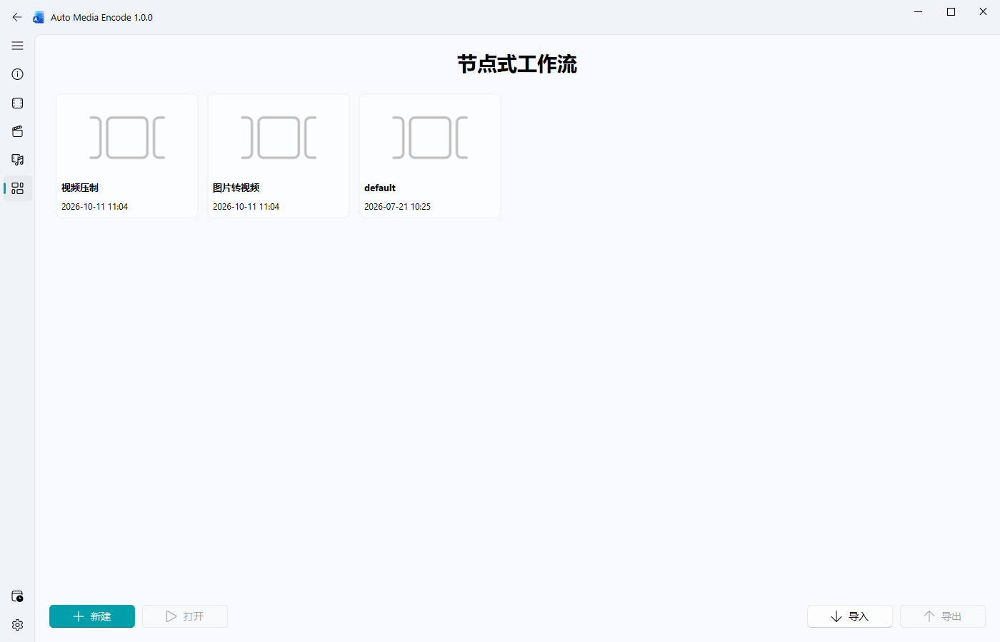
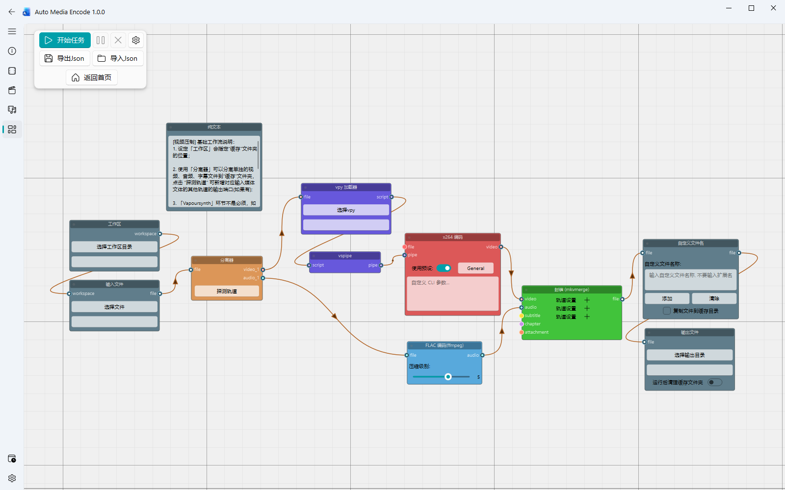

# AME 节点式工作流使用说明

## 概述

AME 工作流把**媒体处理**，尤其是**视频压制**的完整流程拆分为一个个节点。以常见的动漫 BD 压制为例，一次处理可能包含几条并行的素材准备流程：

```text
m2ts ──→ VS/AVS 预处理 ──→ AVC / HEVC / AV1 视频编码 ──┐
m2ts ────────────────────→ 音频编码 ───────────────────┤
mpls ────────────────────→ 章节文件 ───────────────────┤
字幕、附件等素材 ───────────────────────────────────────┘
                                                收集轨道并封装
```

AME 用**节点**和**连线**把这些步骤搭成一条可以一次执行的处理流程。你也可以按自己的素材和处理习惯，组合其他节点与工具，搭建不同的工作流。

AME 工作流中节点的**本质**依旧是对应实际的文件处理：
节点接收上游传来的文件，调用相应工具处理后，再把结果交给下游节点。这和手动逐次调用工具加工媒体文件的逻辑相同，只是把步骤与数据流放在画布上连接起来，便于保存和重复执行。

## 基本介绍
### 打开或新建工作流

在左侧导航栏选择“AME 工作流”进入工作流加载页。页面中的卡片代表已保存的工作流；可以单击卡片后选择“打开”，也可以双击卡片直接打开。AME 自带“视频压制”“图片转视频”和 `default` 示例。



“新建”会创建一个基础画布，其中包含“工作区”“输入文件”和“输出文件”节点，并预先连接工作区与输入节点。第一次保存时需要填写工作流名称，之后可以在画布中按 `Ctrl+S` 保存。

加载页底部的“导入”会把 JSON 工作流加入已保存工作流列表；选中卡片后按“导出”可将它另存为 JSON。右键卡片可以重命名、删除或设置封面。

### 认识画布和节点

节点左侧是输入端口，右侧是输出端口。把上游节点的输出端口拖到下游节点的输入端口，即可建立数据连接。连接表示上游处理完成后，下游节点接收其输出文件。

端口颜色用来区分常见数据类型：视频为红色、音频为青色、字幕为黄色、章节为紫色、通用文件为灰色。

画布空白处右键可打开节点分类菜单；添加后可拖动节点来整理画布。节点右键菜单可以复制、剪切、删除节点或禁用节点。

### 从示例开始：视频压制

“视频压制”预置展示了一条较完整的处理链路，也附带一个说明文本来简单介绍工作流的使用。打开卡片后可以先查看节点和连线，再替换输入文件、脚本、编码设置和输出目录。



示例中的主要数据流如下：

1. **工作区 → 输入文件 → 分离器**：选择工作区与输入媒体。分离器探测轨道后生成视频、音频等输出端口。
2. **视频支路**：视频轨道一般接入视频编码器，VapourSynth 不是必要流程。如果使用 VPY 加载器，选择 `.vpy` 脚本后，VSPipe 把脚本输出接到 x264 编码器的 `pipe` 输入。x264、x265、SVT-AV1 和 FFmpeg 视频编码器可用于不同的视频处理方式。
3. **音频支路**：音频轨道可直接接入 FLAC、AAC、Opus 或 FFmpeg 音频编码器，也可以按需求送往封装器。
4. **封装与输出**：把编码后的视频、音频及需要的字幕、章节或附件接入 mkvmerge 封装器，再经过自定义文件名节点（可选）连接到输出文件节点。

VPY 加载器会把输入视频路径替换进脚本中：脚本可以使用 `__INPUT_FILE__` 占位符，也可以使用软件支持的 VapourSynth 源滤镜路径格式。普通文件编码时，将媒体文件连接到编码器的 `file` 端口；使用 VSPipe 管道时，将 `pipe` 端口接到编码器的 `pipe` 输入。

## 自己搭建一个工作流

### 1. 配置输入、工作区和输出

新建工作流后，先在“工作区”节点中选择中间文件存放目录，在“输入文件”节点中选择源媒体，并在“输出文件”节点中选择最终输出目录。工作区可以帮助集中管理缓存文件。

如果要处理蓝光原盘，可使用“BD 规范化输入”节点选择 `.m2ts`、`.mts` 或 `.mpls` 文件。它会探测并生成对应的轨道端口，包括可识别的章节轨道。普通视频文件也可使用“视频规范化输入”节点自动探测轨道；简单场景可直接使用“输入文件”节点。

### 2. 添加处理节点并连接

在画布空白处右键，按分类添加分离器、编码器或封装器。按媒体处理顺序把输出端口连到下游输入端口。视频和音频可以分成不同支路分别编码，最后接入同一个封装器。

分离器需要先接收上游媒体，再点击节点中的“探测轨道”。探测结果会增加动态输出端口；将需要的轨道连到下游。mkvmerge 封装器可以用轨道设置旁边的“+”添加轨道输入，并设置轨道选项。

### 3. 设置节点参数

在节点内部设置文件、编码预设、编码器、容器和 CLI 参数。节点参数会随工作流保存。使用 VPY 节点时，选择脚本并检查脚本的输入路径替换方式；使用自定义命令行时，确认命令中的输入和输出参数符合该节点要求。

### 4. 保存并执行

在画布左上角浮动工具栏中点击“开始任务”。工作流按节点连接顺序执行；运行中可以暂停、继续或取消。节点状态和底部进度条会显示运行进展。完成后检查输出目录；失败时阅读提示中的节点名称与工具错误信息。

工作流必须包含一个启用的“输出文件”节点，且只能有一个。开始前请确认输出节点收到上游文件，并且所需外部工具已在 AME 设置中配置。

## 节点速查

| 分类 | 节点 | 常见用途 |
|---|---|---|
| 系统 | 工作区 | 设置中间文件和 `temp` 缓存目录的位置。 |
| 系统 | 纯文本 | 在画布上记录文字说明或处理提示。 |
| 系统 | 自定义文件名 | 按名称模板重命名文件，可选择将文件复制到缓存目录。 |
| 输入 | 输入文件、多文件输入 | 载入一个或多个文件。 |
| 输入 | 视频规范化输入 | 选择视频文件并自动探测轨道、生成输出端口。 |
| 输入 | BD 规范化输入 | 选择 `.m2ts`、`.mts` 或 `.mpls` 并探测视频、音频、字幕或章节轨道。 |
| 处理 | 分离器 | 探测并提取输入媒体中已连接的视频、音频或字幕轨道。 |
| 处理 | VPY 加载器、VSPipe | 加载 VapourSynth 脚本，将帧通过管道传给视频编码器。 |
| 处理 | FFmpeg 处理器 | 使用自定义 FFmpeg 参数处理输入文件。 |
| 视频编码 | x264、x265、SVT-AV1、FFmpeg 视频编码器 | 编码视频文件或 VSPipe 管道。 |
| 音频编码 | AAC、FLAC、Opus、FFmpeg 音频编码器 | 编码音频文件或轨道。 |
| 封装 | mkvmerge、FFmpeg 封装器 | 把视频、音频和支持的其他轨道封装为媒体文件。 |
| 输出 | 输出文件 | 将上游生成的文件移动到指定输出目录。 |

## 保存、导入与画布操作

画布左上角工具栏默认显示开始、暂停、取消和更多设置按钮。点击齿轮可展开“导出 JSON”“导入 JSON”和“返回首页”。画布右键菜单也提供文件、编辑、节点和视图操作。

| 操作 | 快捷键 |
|---|---|
| 保存当前工作流 | `Ctrl+S` |
| 撤销 / 重做 | `Ctrl+Z` / `Ctrl+Shift+Z` |
| 复制 / 剪切 / 粘贴节点 | `Ctrl+C` / `Ctrl+X` / `Ctrl+V` |
| 复制选中节点 | `Ctrl+D` |
| 全选 / 删除 | `Ctrl+A` / `Delete` |
| 适应节点 / 重置缩放 | `F` / `Ctrl+0`（`H` 也可重置缩放） |

在画布中导入 JSON 会把文件载入当前编辑器；首次保存时可以为它命名。加载页的导入则会创建一个已保存的工作流卡片。导出 JSON 可以在画布与加载页分别使用，前者导出当前画布，后者导出选中的已保存工作流。

## 缓存、文件和工具

- 工作区节点优先决定 `temp` 缓存目录；没有可用工作区时，AME 会尝试使用输出目录或输入文件所在目录下的 `temp` 文件夹。
- 输出节点会保留已有文件。遇到同名输出时，AME 会自动在文件名后追加序号，例如 `video (1).mkv`。
- 只有输出节点开启“运行后清理缓存文件夹”且工作流成功完成时，才会清理缓存。失败或取消时缓存会保留。
- 禁用节点不会自动绕过。如果启用的下游节点仍依赖已禁用的上游节点，AME 会阻止执行并提示调整节点或连线。
- 输入文件或 BD 轨道仍在探测时，请等待探测结束再启动工作流。
- 工作流依赖的外部工具需在设置页配置或放入 `tools/` 目录，例如 FFmpeg、mkvmerge、mkvextract、eac3to、x264、x265、SVT-AV1 和 vspipe。缺少工具时，相关节点无法执行。

